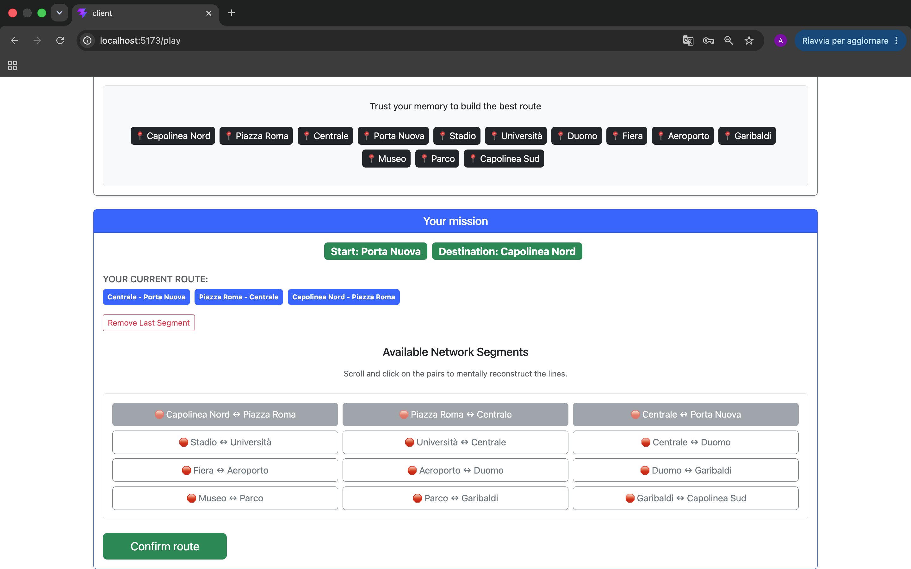
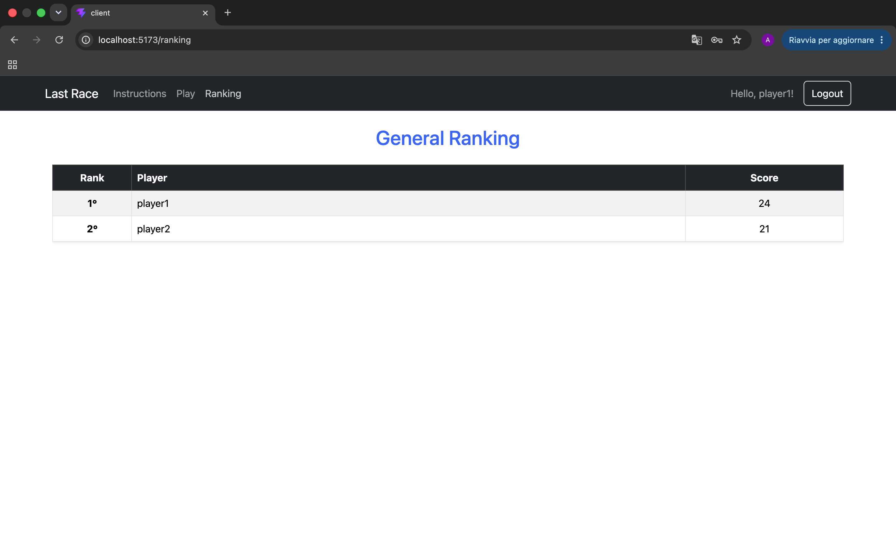

# Last Race

A full-stack web game: plan the fastest route across a metro network, survive the random events of the journey, and climb the global ranking.

Individual project for the Web Applications I course at Politecnico di Torino.



## How the game works

1. **Setup:** you get a random start station and destination on the metro network
2. **Planning:** build your route segment by segment on the network map
3. **Execution:** the journey runs step by step, and random events (good and bad) change your coin balance
4. **Result:** your final score is saved and enters the global ranking

Anonymous visitors can read the rules; playing and the ranking require login.

## Tech stack

| Layer | Technologies |
| --- | --- |
| Client | React 19, React Router, React-Bootstrap, Vite |
| Server | Node.js, Express 5, REST API |
| Auth | Passport (local strategy), express-session, salted password hashes |
| Database | SQLite (the metro network is stored as a graph of stations, lines and segments) |

## Getting started

Start the server:

```bash
cd server
npm install
node index.js
```

In a second terminal, start the client:

```bash
cd client
npm install
npm run dev
```

Then open the URL printed by Vite (by default http://localhost:5173).

### Test accounts

| Username | Password | Notes |
| --- | --- | --- |
| player1 | password123 | some games played |
| player2 | password456 | some games played |
| player3 | password789 | no games played |

## Client routes

- `/` — home page with the game rules
- `/login` — login page
- `/play` — the game (authenticated users only): Setup, Planning, Execution, Result
- `/ranking` — global ranking with each user's best score
- `*` — 404 page

## API

| Method | Endpoint | Description |
| --- | --- | --- |
| POST | `/api/sessions` | Log in with username and password |
| GET | `/api/sessions/current` | Current user, or 401 if not logged in |
| DELETE | `/api/sessions/current` | Log out |
| GET | `/api/network` | All stations, lines and segments |
| GET | `/api/game/setup` | Random start and destination, minimum distance, available segments |
| POST | `/api/game/execute` | Run the planned route: steps, random events and final score |
| GET | `/api/ranking` | Users sorted by best score |

<details>
<summary>Request and response examples</summary>

`POST /api/sessions`

```json
{ "username": "player1", "password": "password" }
```

Response:

```json
{ "id": 1, "username": "player1" }
```

`GET /api/game/setup`

```json
{
  "startStation": { "id": 10, "name": "Garibaldi" },
  "destStation": { "id": 6, "name": "Università" },
  "minDistance": 3,
  "segments": [{ "stationA": 1, "stationB": 2, "lineId": 1 }]
}
```

`POST /api/game/execute`

```json
{
  "route": [{ "stationA": 1, "stationB": 2, "lineId": 1 }],
  "startStationId": 1,
  "destStationId": 8
}
```

Response:

```json
{
  "success": true,
  "journeySteps": [
    {
      "segment": { "stationA": 1, "stationB": 2, "lineId": 1 },
      "event": { "description": "Kind passenger", "effect": 1 },
      "coinsAfterStep": 21
    }
  ],
  "finalScore": 21
}
```

`GET /api/ranking`

```json
[
  { "username": "player1", "score": 24 },
  { "username": "player2", "score": 21 }
]
```

</details>

## Database

| Table | Content |
| --- | --- |
| `users` | id, username, password_hash, salt |
| `stations` | id, name |
| `lines` | id, name |
| `segments` | stationA, stationB, line_id (the edges of the network graph) |
| `events` | id, description, effect |
| `games` | id, user_id, score |

## Main React components

- `App` — layout, routing and global authentication state
- `LoginForm` — login form and authentication
- `GameManager` — core of `/play`, drives the four game phases
- `NetworkMap` — visual map of the network, used in Setup and Planning
- `RouteBuilder` — lets the player build the route during Planning
- `ExecutionViewer` — shows the journey step by step, with events and the coin balance
- `Ranking` — the global ranking



## Use of AI tools

I used Gemini only as a styling assistant, to suggest React-Bootstrap classes (such as Card layouts) for the user interface. I reviewed every suggestion against the official React-Bootstrap documentation and tested the result in the browser.
